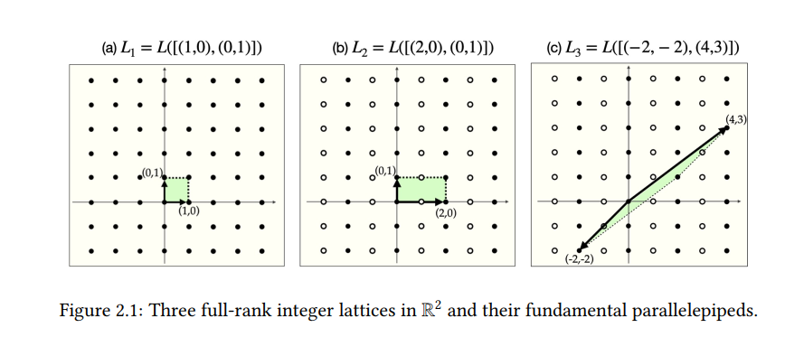

## 1. Basic Definitions

**Definition 1.1** *The lattice $L$* in $\mathbb{R}^n$ consists of all vectors of the form

$$
v = c_1b_1 + c_2b_2 + \cdots + c_mb_m,
$$

where the scalars $c_i$ are integers. The basis $B$ can be represented by an $n \times m$ *basis matrix*, also denoted by $B$, whose columns are the basis vectors $b_1, b_2, \dots, b_m$:

$$
B = \begin{bmatrix}
| & | & \cdots & | \\
b_1 & b_2 & \cdots & b_m \\
| & | & \cdots & |
\end{bmatrix}.
$$

With this notation, the lattice can be described compactly as $L = \{Bx : x \in \mathbb{Z}^m\}$. The dimension of $L$ is $n$, and the rank of $L$ is $m$.

**Definition 1.2** *A full-rank lattice $L$* in $\mathbb{R}^n$ is a lattice of rank $n$.

If $L$ is a full-rank lattice in $\mathbb{R}^n$ with basis $B = [b_1, b_2, \dots, b_n]$, then $B$ is also a basis of the vector space $\mathbb{R}^n$. The lattice $L$ consists of all *integer* linear combinations of $b_1, b_2, \dots, b_n$, whereas the vector space $\mathbb{R}^n$ consists of all *real* linear combinations of these same vectors.

**Definition 1.3** Let $L$ and $L'$ be lattices in $\mathbb{R}^n$. Then $L'$ is a *sublattice* of $L$ if $L' \subseteq L$.

To show that $L'$ is a sublattice of $L$, it suffices to verify that each vector $b'$ in a basis $B'$ of $L'$ is an element of $L$; that is, it can be expressed as an integer linear combination of the vectors in a basis $B$ of $L$.

## 2. Fundamental Parallelepiped and Examples

**Definition 2.6** Let $L = L(B)$ be a full-rank lattice in $\mathbb{R}^n$ with basis $B = [b_1, b_2, \dots, b_n]$. The *fundamental parallelepiped* of $L$ (with respect to the basis $B$) is defined as

$$
P(B) = \{a_1b_1 + a_2b_2 + \cdots + a_nb_n : a_i \in [0, 1)\}.
$$

Equivalently, $P(B) = \{Bx : x \in [0, 1)^n\}$.

The fundamental parallelepiped $P(B)$ partitions $\mathbb{R}^n$ into non-overlapping regions known as *parallelepipeds*. The "corners" of these parallelepipeds are precisely the lattice points of $L(B)$.

**Example 2.8** Consider the basis $B_2 = [(2, 0), (0, 1)]$. The lattice generated by $B_2$ is

$$
L_2 = L(B_2) = \{B_2x : x \in \mathbb{Z}^2\}, \quad \text{where } B_2 = \begin{bmatrix} 2 & 0 \\ 0 & 1 \end{bmatrix}.
$$

Now consider the basis $B_3 = [(-2, -2), (4, 3)]$. The lattice generated by $B_3$ is

$$
L_3 = L(B_3) = \{B_3x : x \in \mathbb{Z}^2\}, \quad \text{where } B_3 = \begin{bmatrix} -2 & 4 \\ -2 & 3 \end{bmatrix}.
$$

It turns out that $L_2$ and $L_3$ are in fact the same lattice. This can be confirmed by verifying that each lattice is a sublattice of the other. Indeed, $L_2 \subseteq L_3$ since

$$
(2, 0) = 3 \cdot (-2, -2) + 2 \cdot (4, 3) \quad \text{and} \quad (0, 1) = -2 \cdot (-2, -2) - 1 \cdot (4, 3),
$$

and $L_3 \subseteq L_2$ since

$$
(-2, -2) = -1 \cdot (2, 0) - 2 \cdot (0, 1) \quad \text{and} \quad (4, 3) = 2 \cdot (2, 0) + 3 \cdot (0, 1).
$$

> **Remark:** Two distinct basis matrices ($B_2 \neq B_3$) may generate the same lattice ($L_2 = L_3$).

## 3. Bases of a Lattice

Let $L = L(B)$ be an $n$-dimensional lattice in $\mathbb{R}^n$ with ordered basis $B = [b_1, b_2, \dots, b_n]$. The following elementary column operations transform $B$ into another basis for the same lattice:

1. Exchange two basis vectors: $b_i \leftrightarrow b_j$.
2. Replace a basis vector by its negation: $b_i \leftarrow -b_i$.
3. Add an integer multiple of one basis vector to another: $b_i \leftarrow b_i + cb_j$, where $c \in \mathbb{Z}$.

**Theorem 2.9** *(Characterization of Lattice Bases)* Let $L = L(B_1)$ be an $n$-dimensional lattice. An $n \times n$ matrix $B_2$ is also a basis for $L$ if and only if $B_2 = B_1U$, where $U$ is an $n \times n$ matrix with integer entries and determinant $\pm 1$. (Such a matrix $U$ is called *unimodular*.)

**Proof:**

$(\Rightarrow)$ Suppose that $B_1$ and $B_2$ are both bases of the lattice $L$, so that $L(B_1) = L(B_2)$.

Let $B_2 = [b'_1, b'_2, \dots, b'_n]$. By definition, every lattice vector $v \in L(B_2)$ can be written as an integer linear combination:

$$
v = c_1 b'_1 + c_2 b'_2 + \cdots + c_n b'_n, \quad \text{where } c_i \in \mathbb{Z}.
$$

By successively setting one coefficient $c_i = 1$ and all remaining coefficients to $0$, we obtain the vectors

$$
v_1 = 1 \cdot b'_1, \quad v_2 = 1 \cdot b'_2, \quad \dots, \quad v_n = 1 \cdot b'_n,
$$

which shows that $\{b'_1, b'_2, \dots, b'_n\} \subset L(B_2)$. Since $L(B_2) = L(B_1)$, each basis vector $b'_i$ belongs to $L(B_1)$ for all $i = 1, 2, \dots, n$. Thus, there exist integer vectors $u_1, u_2, \dots, u_n \in \mathbb{Z}^n$ such that

$$
b'_1 = B_1 u_1, \quad b'_2 = B_1 u_2, \quad \dots, \quad b'_n = B_1 u_n.
$$

Therefore,

$$
\begin{bmatrix} b'_1 & b'_2 & \dots & b'_n \end{bmatrix} = B_1 \begin{bmatrix} u_1 & u_2 & \dots & u_n \end{bmatrix} \implies B_2 = B_1 U, \quad \text{where } U \in \mathbb{Z}^{n \times n}.
$$

Similarly, there exists an integer matrix $V \in \mathbb{Z}^{n \times n}$ such that $B_1 = B_2 V$. Substituting $B_2 = B_1 U$ into $B_1 = B_2 V$ yields

$$
B_1 = B_2 V = (B_1 U) V = B_1 (UV).
$$

Since $B_1$ is invertible, it follows that $UV = I_n$. Taking determinants on both sides gives

$$
\det(UV) = \det(U)\det(V) = 1,
$$

which implies that $\det(U) = \det(V) = 1$ or $\det(U) = \det(V) = -1$. Hence, $U$ is unimodular and $B_2 = B_1 U$.

$(\Leftarrow)$ Conversely, suppose that $B_2 = B_1U$ for some unimodular matrix $U$. Take an arbitrary vector $v \in L(B_2)$, so that

$$
v = B_2 x, \quad \text{where } x \in \mathbb{Z}^n.
$$

Substituting $B_2 = B_1 U$ into the expression above yields

$$
v = (B_1 U)x = B_1(Ux) = B_1y,
$$

where:
* $U \in \mathbb{Z}^{n \times n}$ is a matrix with integer entries,
* $x \in \mathbb{Z}^n$ is an integer vector, and
* $y = Ux \in \mathbb{Z}^n$.

Since $v = B_1 y$ with $y \in \mathbb{Z}^n$, it follows that $v \in L(B_1)$. Therefore, $L(B_2) \subseteq L(B_1)$.

Recall the matrix inverse formula

$$
U^{-1} = \frac{\operatorname{adj}(U)}{\det(U)}.
$$

Since the adjugate matrix $\operatorname{adj}(U)$ has integer entries and $\det(U) = \pm 1$, it follows that $U^{-1}$ also has integer entries and $\det(U^{-1}) = \pm 1$; thus, $U^{-1}$ is unimodular. Multiplying $B_2 = B_1U$ on the right by $U^{-1}$ gives $B_1 = B_2U^{-1}$, which implies that $L(B_1) \subseteq L(B_2)$.

Therefore, $L(B_1) = L(B_2)$, proving that $B_2$ is also a basis for $L$. $\blacksquare$

### Volume of a Lattice

The volume of a lattice provides a quantitative measure of how densely the lattice points are distributed in space: larger volumes correspond to sparser lattices.

**Definition 2.11** The *volume* of a lattice $L = L(B)$ is defined as $\operatorname{vol}(L) = |\det(B)|$.

If $B'$ is any other basis of $L = L(B)$, then $B' = BU$ for some unimodular matrix $U$. Consequently, $\det(B') = \det(B)\det(U)$, and hence $\det(B') = \pm \det(B)$. It follows that $|\det(B')| = |\det(B)|$. This shows that the volume is a *lattice invariant*, meaning that it is independent of the particular basis chosen to represent the lattice.

## 4. Successive Minima

**Definition 2.12** Let $L \subseteq \mathbb{R}^n$ be a lattice. For each $i \in [1, n]$, the *$i$th successive minimum* $\lambda_i(L)$ is defined as the smallest real number $r$ such that $L$ contains $i$ linearly independent vectors, each of length at most $r$.

By definition, the successive minima form a non-decreasing sequence:

$$
\lambda_1(L) \le \lambda_2(L) \le \cdots \le \lambda_n(L).
$$

The first successive minimum, $\lambda_1(L)$, is simply the length of a shortest nonzero vector in $L$.

**Definition 2.14** For each integer $n \ge 1$, the *Hermite constant* $\gamma_n$ is defined by

$$
\gamma_n = \max_{L} \left( \frac{\lambda_1(L)}{\operatorname{vol}(L)^{1/n}} \right)^2, \tag{2}
$$

where the maximum is taken over all full-rank lattices $L \subseteq \mathbb{R}^n$.

It follows immediately from (2) that every full-rank lattice $L \subseteq \mathbb{R}^n$ satisfies

$$
\lambda_1(L) \le \sqrt{\gamma_n} \operatorname{vol}(L)^{1/n}.
$$

Hermite proved that

$$
\gamma_n \le \left(\frac{4}{3}\right)^{(n-1)/2},
$$

which yields an upper bound on $\lambda_1(L)$:

$$
\lambda_1(L) \le \left(\frac{4}{3}\right)^{(n-1)/4} \operatorname{vol}(L)^{1/n}.
$$

In 1896, Minkowski gave a much improved upper bound on the first successive minimum.

**Theorem 2.15** *(Minkowski's Theorem)* Let $L \subseteq \mathbb{R}^n$ be a full-rank lattice. Then

$$
\lambda_1(L) \le \sqrt{n} \operatorname{vol}(L)^{1/n}.
$$

Minkowski's Theorem immediately gives a linear upper bound on the Hermite constants:

$$
\gamma_n \le n.
$$

The bound in Minkowski's Theorem is not tight in general. Nevertheless, the *Gaussian heuristic* suggests that, for a suitably defined notion of a random full-rank lattice, this bound is close to optimal. More specifically, the expected length of a shortest nonzero vector in such a lattice is approximately

$$
\lambda_1(L) \approx \sqrt{\frac{n}{2\pi e}} \operatorname{vol}(L)^{1/n}.
$$

**Theorem 2.16** *(Minkowski's Second Theorem)* Let $L \subseteq \mathbb{R}^n$ be a full-rank lattice. Then

$$
\left( \prod_{i=1}^{n} \lambda_i(L) \right)^{1/n} \le \sqrt{n} \operatorname{vol}(L)^{1/n}.
$$

## 5. Fundamental Lattice Problems

### 5.1 Shortest Vector Problem (SVP) and Approximate SVP

**Definition 2.17** The *Shortest Vector Problem* ($\text{SVP}$): Given a lattice $L = L(B)$, find a nonzero lattice vector of smallest length $\lambda_1(L)$.

**Definition 2.18** The *Approximate Shortest Vector Problem* ($\text{approx-SVP}$ or $\text{SVP}_\gamma$): Given a lattice $L = L(B)$, find a nonzero lattice vector of length at most $\gamma \cdot \lambda_1(L)$, where $\gamma$ is the approximation factor.

* **Hardness:**
  * $\text{SVP}_1$ is the exact Shortest Vector Problem ($\text{SVP}$).
  * When $\gamma$ is a constant, $\text{SVP}_\gamma$ is NP-hard.
  * When $\gamma > \sqrt{n}$, the problem is unlikely to be NP-hard.
  * When $\gamma = 2^{O(n \log \log n / \log n)}$, the problem can be solved in polynomial time using the BKZ / LLL algorithms.

### 5.2 Shortest Independent Vectors Problem (SIVP) and Approximate SIVP

**Definition 2.19** The *Shortest Independent Vectors Problem* ($\text{SIVP}$): Given a lattice $L = L(B)$, find $n$ linearly independent lattice vectors, each of length at most $\lambda_n(L)$.

**Definition 2.20** The *Approximate Shortest Independent Vectors Problem* ($\text{approx-SIVP}$ or $\text{SIVP}_\gamma$): Given a lattice $L = L(B)$, find $n$ linearly independent lattice vectors, each of length at most $\gamma \cdot \lambda_n(L)$.

### 5.3 Closest Vector Problem (CVP) and Approximate CVP

**Definition 2.21** Let $L \subseteq \mathbb{R}^n$ and let $t \in \mathbb{R}^n$. The *distance* from $t$ to $L$ is defined by

$$
\operatorname{dist}(t, L) = \min_{x \in L} \|x - t\|.
$$

**Definition 2.22** The *Closest Vector Problem* ($\text{CVP}$): Given a lattice $L = L(B)$ and a target vector $t \in \mathbb{R}^n$, find a lattice vector $x \in L$ that is closest to $t$, that is, satisfying $\|x - t\| = \operatorname{dist}(t, L)$.

**Definition 2.23** The *Approximate Closest Vector Problem* ($\text{approx-CVP}$ or $\text{CVP}_\gamma$): Given a lattice $L = L(B)$ and a target vector $t \in \mathbb{R}^n$, find a lattice vector $x \in L$ such that $\|x - t\| \le \gamma \cdot \operatorname{dist}(t, L)$.

> **Remark:** Let $L \subseteq \mathbb{R}^n$ be a full-rank lattice. There exists $x \in L$ with $0 < \|x\|_\infty \le \operatorname{vol}(L)^{1/n}$.